# Panduan lengkap portal warga Mina Go

Panduan warga pengelola dan operasional MySQL

Versi 3 November 2026

Dokumen ini menjelaskan seluruh halaman pengguna, alur persuratan, pengelolaan layanan dan UMKM, serta cara menjalankan dan menyiapkan aplikasi berbasis MySQL. Setiap tangkapan layar dilengkapi keterangan dan langkah penggunaan.

Warga dapat mengakses layanan tanpa akun. Akun admin diperlukan untuk mengubah layanan, pengurus, dan usaha. Persuratan menyiapkan percakapan WhatsApp; proses pengajuan dan pengiriman pesan dilanjutkan oleh pengguna pada WhatsApp.

Gambar diambil melalui Playwright Chromium dari salinan database MySQL. Akun dokumentasi, nama pengurus, dan nomor kontak pada gambar merupakan data contoh. Database aplikasi aktif tidak digunakan untuk demonstrasi perubahan data.

## Peta isi panduan

- Gambaran aplikasi dan pembagian akses
- Halaman warga dan panel berbagi
- Persuratan lengkap dengan delapan jenis layanan
- Login dashboard dan seluruh kanal pengelolaan
- Form pengurus tombol layanan dan UMKM
- Penggunaan pada ponsel
- Menjalankan lokal hosting MySQL backup dan pemecahan masalah

## Pembagian akses dan cara membaca gambar

Warga membuka portal, memilih kanal, melihat UMKM, dan memulai persuratan. Admin mengelola konten dan melihat ringkasan pengunjung. Pengelola server membuat akun, menyiapkan database, mengatur konfigurasi, dan melakukan backup.

Screenshot menampilkan halaman nyata aplikasi, bukan rancangan tampilan. Setiap screenshot ditampilkan utuh sebagai satu gambar tanpa dipotong menjadi beberapa bagian. Ukuran halaman mengikuti panjang screenshot agar gambar tetap terbaca. Tampilan data dan angka statistik dapat berubah setelah website digunakan.

Alamat pada gambar menggunakan localhost:4176 khusus sesi dokumentasi. Alamat penggunaan lokal standar adalah http://localhost:4173. Pada hosting, gunakan alamat HTTPS domain yang sudah dikonfigurasi.

## 01 Beranda portal warga

Portal warga menyatukan layanan lingkungan RW 12 Villa Ilhami Blok Mina. Halaman utama menyediakan tiga kanal yang dapat dibuka tanpa akun warga.

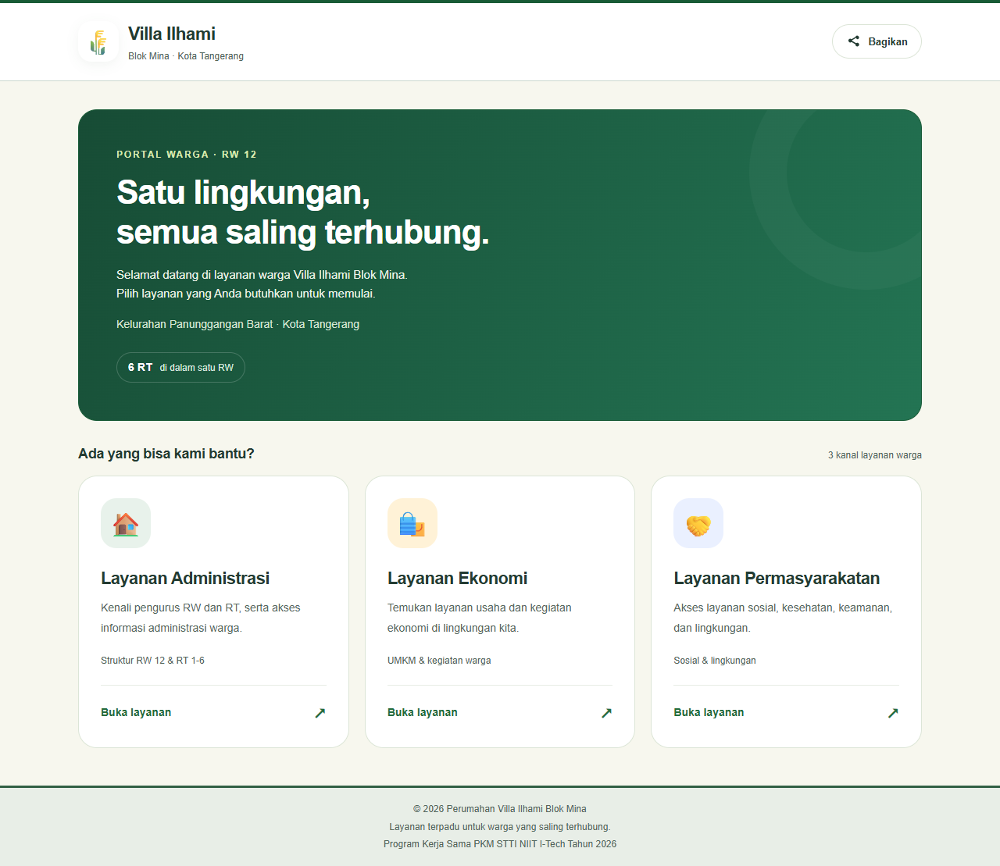
Gambar 1  Beranda portal warga

1. Buka alamat website dari browser komputer atau ponsel.
2. Pilih Administrasi, Ekonomi, atau Permasyarakatan sesuai kebutuhan.
3. Gunakan logo Villa Ilhami untuk kembali ke beranda.

Alamat halaman: `/`

## 02 Bagikan portal

Panel Bagikan menyediakan tautan portal dan pilihan berbagi melalui aplikasi lain. Tautan yang dibagikan pada implementasi ini mengarah ke beranda portal.

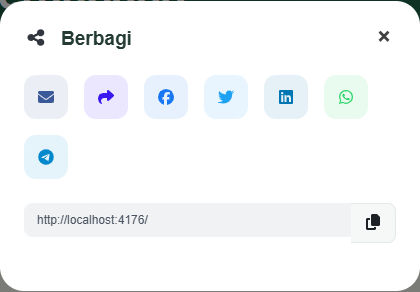
Gambar 2  Bagikan portal

1. Tekan Bagikan di bagian atas halaman.
2. Pilih WhatsApp, Telegram, email, Facebook, X, atau LinkedIn; aplikasi tujuan menangani langkah berikutnya.
3. Gunakan tombol salin untuk menyalin alamat. Tutup panel melalui tombol tutup atau Escape. Pilihan berbagi perangkat muncul bila browser mendukungnya.

Alamat halaman: `/`

## 03 Layanan Administrasi

Layanan Administrasi menampilkan struktur pengurus RW 12 dan RT 1 sampai RT 6, kontak layanan, serta akses Persuratan. Nama dan nomor berasal dari data yang dikelola admin.

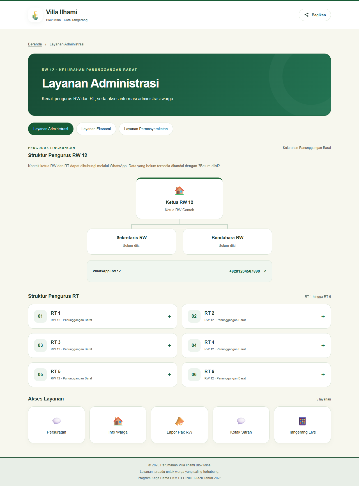
Gambar 3  Layanan Administrasi

1. Periksa jabatan dan nama pengurus pada struktur organisasi.
2. Pilih kontak yang memiliki tautan WhatsApp, atau buka Persuratan pada Akses Layanan.
3. Nomor yang belum diisi tidak dapat digunakan sebagai tujuan persuratan. Kerangka sekretaris dan bendahara belum memiliki form pengelolaan tersendiri.

Alamat halaman: `/?layanan=administrasi`

## 04 Layanan Ekonomi

Layanan Ekonomi mengumpulkan akses layanan ekonomi dan direktori UMKM warga. Tombol pada kanal ini dapat menuju WhatsApp atau website lain sesuai pengaturan admin.

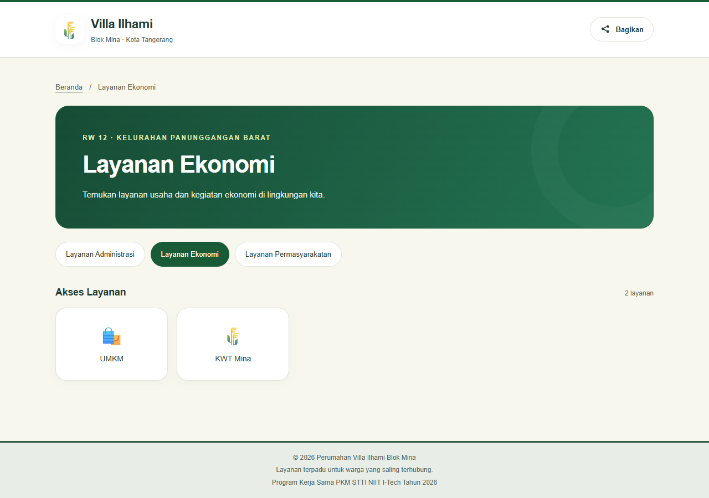
Gambar 4  Layanan Ekonomi

1. Buka Layanan Ekonomi.
2. Pilih tombol layanan yang dibutuhkan.
3. Pilih UMKM untuk melihat nama usaha, kategori, deskripsi, alamat, dan kontak yang tersedia.

Alamat halaman: `/?layanan=ekonomi`

## 05 Layanan Permasyarakatan

Layanan Permasyarakatan menyediakan kontak layanan sosial, kesehatan, keamanan, dan lingkungan. Isi tombol dan tujuannya mengikuti konfigurasi pengelola.

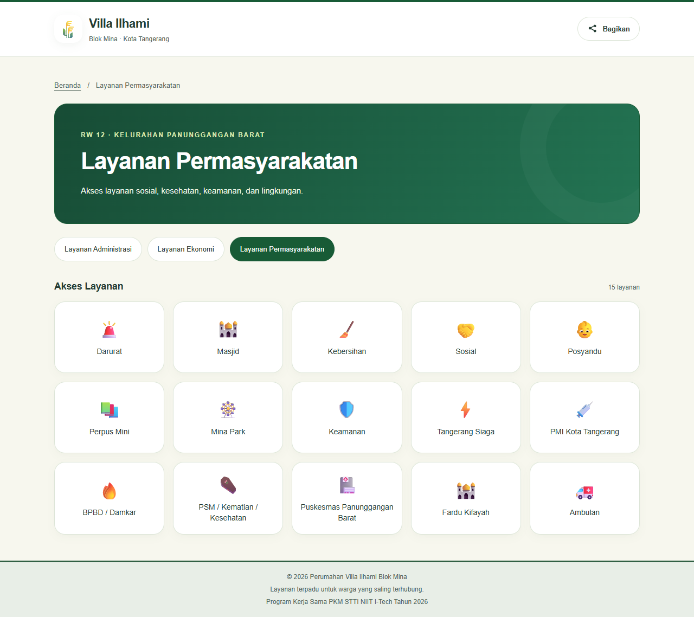
Gambar 5  Layanan Permasyarakatan

1. Buka Layanan Permasyarakatan.
2. Pilih layanan yang sesuai.
3. Periksa penerima dan isi pesan pada aplikasi tujuan sebelum melanjutkan. Website tidak mengirim pesan secara otomatis.

Alamat halaman: `/?layanan=permasyarakatan`

## 06 Direktori UMKM

Direktori UMKM menyajikan usaha warga dalam kartu berisi nama, kategori, deskripsi dan alamat. Kontak WhatsApp hanya tersedia jika nomor telah diisi.

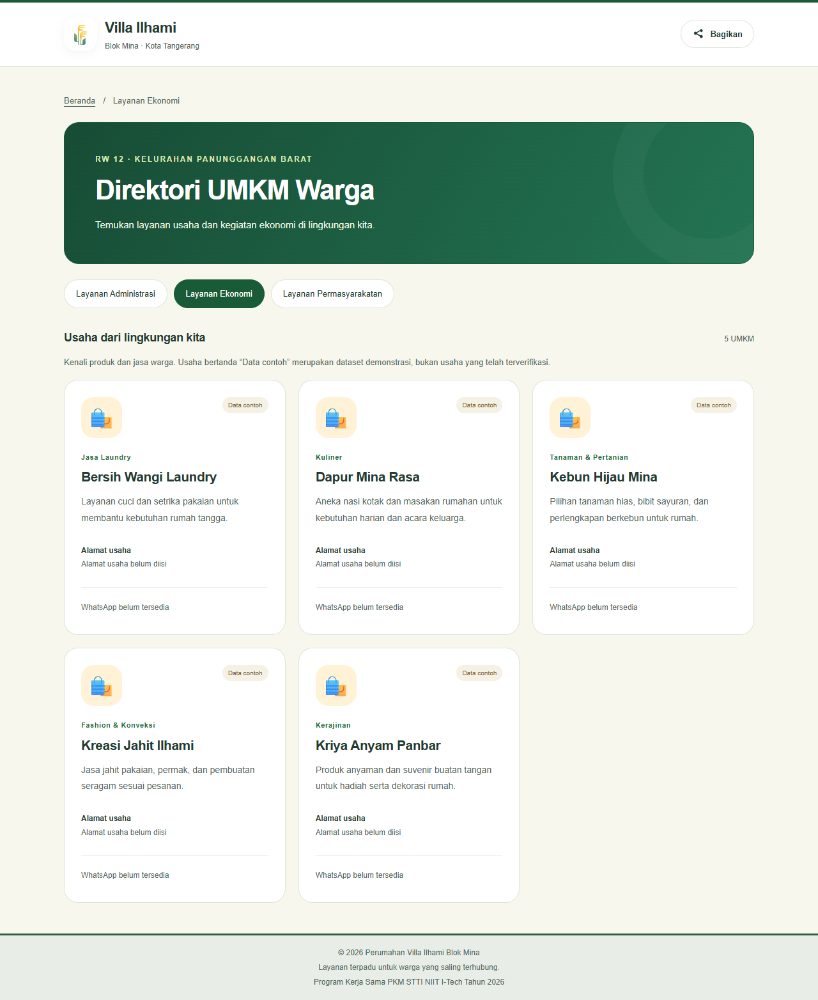
Gambar 6  Direktori UMKM

1. Masuk melalui Ekonomi kemudian UMKM.
2. Baca informasi usaha dan penanda Data contoh.
3. Hubungi usaha melalui tombol WhatsApp bila tersedia. Data contoh merupakan demonstrasi dan harus diverifikasi atau diganti sebelum dipublikasikan.

Alamat halaman: `/?layanan=ekonomi&direktori=umkm`

## 07 Pilihan layanan surat

Persuratan menyediakan delapan keperluan: Pengantar Umum, Keterangan Domisili, SKTM, Keterangan Usaha, Pengantar Nikah, Lapor Kelahiran, Lapor Kematian, dan Administrasi Lainnya.

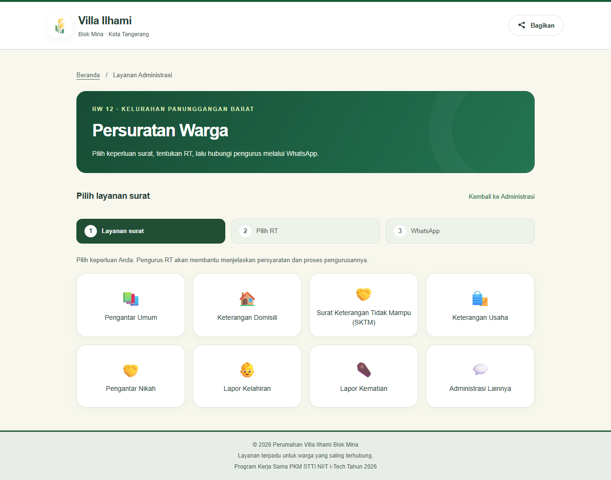
Gambar 7  Pilihan layanan surat

1. Buka Administrasi kemudian Persuratan.
2. Pilih keperluan surat. Indikator tahap menunjukkan Layanan surat, Pilih RT, dan WhatsApp.
3. Jenis surat merupakan bawaan aplikasi dan tidak dikelola melalui tombol layanan admin.

Alamat halaman: `/?layanan=administrasi&persuratan=1`

## 08 Pilihan RT tujuan

Setelah memilih jenis surat, warga memilih RT sesuai tempat tinggal. Sistem menampilkan RT 1 sampai RT 6 beserta nama ketua jika tersedia.

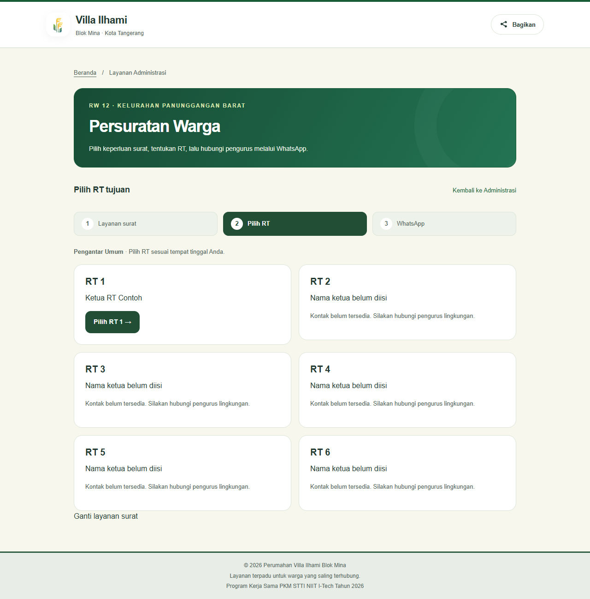
Gambar 8  Pilihan RT tujuan

1. Pilih RT tempat tinggal melalui tombol Pilih RT.
2. RT tanpa nomor valid menampilkan informasi Kontak belum tersedia dan tidak menyediakan tombol lanjut.
3. Gunakan Ganti layanan surat jika jenis keperluan sebelumnya keliru.

Alamat halaman: `/?layanan=administrasi&persuratan=1&surat=umum`

## 09 Pengantar Umum

Pengantar Umum menyiapkan pesan awal untuk konsultasi atau kebutuhan pengantar umum. Ringkasan menampilkan jenis layanan, RT, nama ketua bila tersedia, serta nomor WhatsApp tujuan.

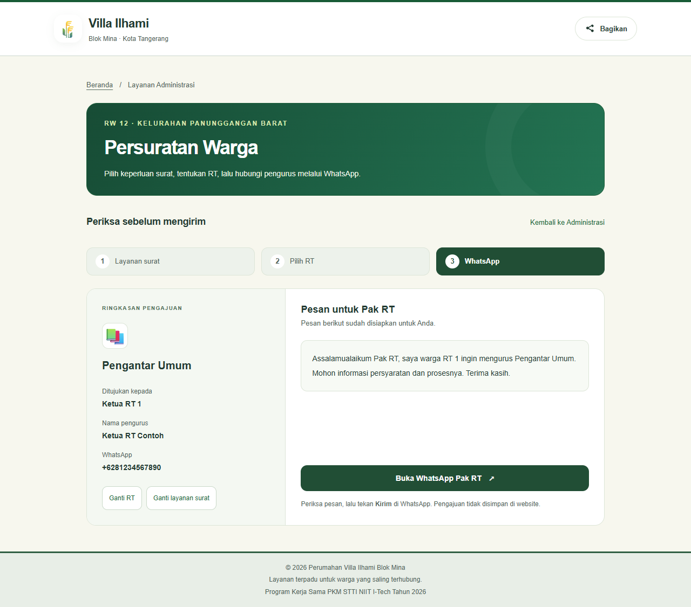
Gambar 9  Pengantar Umum

1. Pilih jenis layanan dan RT sesuai tempat tinggal.
2. Periksa ringkasan dan isi pesan. Gunakan Ganti RT atau Ganti layanan surat bila pilihan keliru.
3. Tekan Buka WhatsApp Pak RT untuk membuka percakapan dengan pesan yang sudah disiapkan. Pengguna tetap menekan Kirim sendiri di WhatsApp.
4. Syarat berkas, kewenangan penerbitan, waktu layanan, dan tindak lanjut dikonfirmasi kepada pengurus atau kelurahan. Website tidak menerbitkan surat, menyediakan tiket, mengunggah berkas, atau menyimpan riwayat permohonan.

Alamat halaman: `/?layanan=administrasi&persuratan=1&surat=umum&rt=rt1`

## 10 Keterangan Domisili

Keterangan Domisili menyiapkan pesan awal untuk konsultasi keterangan tempat tinggal. Ringkasan menampilkan jenis layanan, RT, nama ketua bila tersedia, serta nomor WhatsApp tujuan.


Gambar 10  Keterangan Domisili

1. Pilih jenis layanan dan RT sesuai tempat tinggal.
2. Periksa ringkasan dan isi pesan. Gunakan Ganti RT atau Ganti layanan surat bila pilihan keliru.
3. Tekan Buka WhatsApp Pak RT untuk membuka percakapan dengan pesan yang sudah disiapkan. Pengguna tetap menekan Kirim sendiri di WhatsApp.
4. Syarat berkas, kewenangan penerbitan, waktu layanan, dan tindak lanjut dikonfirmasi kepada pengurus atau kelurahan. Website tidak menerbitkan surat, menyediakan tiket, mengunggah berkas, atau menyimpan riwayat permohonan.

Alamat halaman: `/?layanan=administrasi&persuratan=1&surat=domisili&rt=rt1`

## 11 Surat Keterangan Tidak Mampu

Surat Keterangan Tidak Mampu menyiapkan pesan awal untuk konsultasi kebutuhan SKTM. Ringkasan menampilkan jenis layanan, RT, nama ketua bila tersedia, serta nomor WhatsApp tujuan.

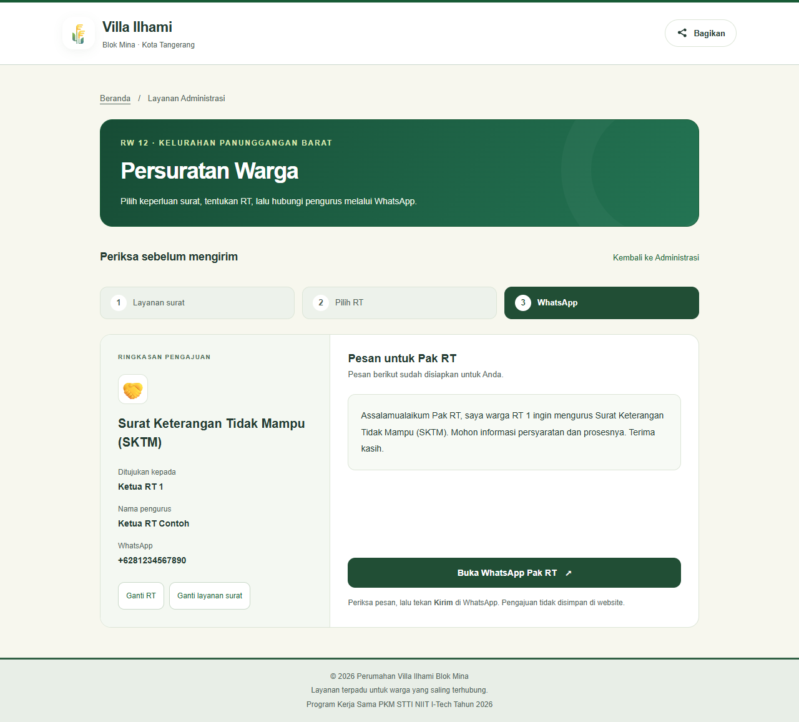
Gambar 11  Surat Keterangan Tidak Mampu

1. Pilih jenis layanan dan RT sesuai tempat tinggal.
2. Periksa ringkasan dan isi pesan. Gunakan Ganti RT atau Ganti layanan surat bila pilihan keliru.
3. Tekan Buka WhatsApp Pak RT untuk membuka percakapan dengan pesan yang sudah disiapkan. Pengguna tetap menekan Kirim sendiri di WhatsApp.
4. Syarat berkas, kewenangan penerbitan, waktu layanan, dan tindak lanjut dikonfirmasi kepada pengurus atau kelurahan. Website tidak menerbitkan surat, menyediakan tiket, mengunggah berkas, atau menyimpan riwayat permohonan.

Alamat halaman: `/?layanan=administrasi&persuratan=1&surat=sktm&rt=rt1`

## 12 Keterangan Usaha

Keterangan Usaha menyiapkan pesan awal untuk konsultasi pengantar atau keterangan usaha. Ringkasan menampilkan jenis layanan, RT, nama ketua bila tersedia, serta nomor WhatsApp tujuan.

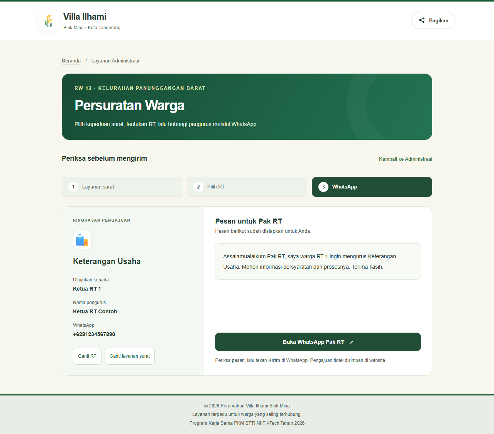
Gambar 12  Keterangan Usaha

1. Pilih jenis layanan dan RT sesuai tempat tinggal.
2. Periksa ringkasan dan isi pesan. Gunakan Ganti RT atau Ganti layanan surat bila pilihan keliru.
3. Tekan Buka WhatsApp Pak RT untuk membuka percakapan dengan pesan yang sudah disiapkan. Pengguna tetap menekan Kirim sendiri di WhatsApp.
4. Syarat berkas, kewenangan penerbitan, waktu layanan, dan tindak lanjut dikonfirmasi kepada pengurus atau kelurahan. Website tidak menerbitkan surat, menyediakan tiket, mengunggah berkas, atau menyimpan riwayat permohonan.

Alamat halaman: `/?layanan=administrasi&persuratan=1&surat=usaha&rt=rt1`

## 13 Pengantar Nikah

Pengantar Nikah menyiapkan pesan awal untuk konsultasi administrasi pernikahan. Ringkasan menampilkan jenis layanan, RT, nama ketua bila tersedia, serta nomor WhatsApp tujuan.

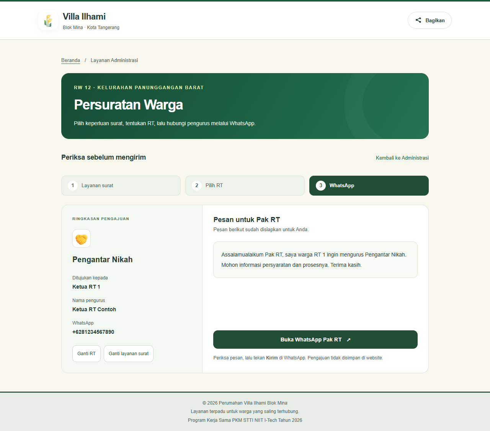
Gambar 13  Pengantar Nikah

1. Pilih jenis layanan dan RT sesuai tempat tinggal.
2. Periksa ringkasan dan isi pesan. Gunakan Ganti RT atau Ganti layanan surat bila pilihan keliru.
3. Tekan Buka WhatsApp Pak RT untuk membuka percakapan dengan pesan yang sudah disiapkan. Pengguna tetap menekan Kirim sendiri di WhatsApp.
4. Syarat berkas, kewenangan penerbitan, waktu layanan, dan tindak lanjut dikonfirmasi kepada pengurus atau kelurahan. Website tidak menerbitkan surat, menyediakan tiket, mengunggah berkas, atau menyimpan riwayat permohonan.

Alamat halaman: `/?layanan=administrasi&persuratan=1&surat=nikah&rt=rt1`

## 14 Lapor Kelahiran

Lapor Kelahiran menyiapkan pesan awal untuk pelaporan peristiwa kelahiran. Ringkasan menampilkan jenis layanan, RT, nama ketua bila tersedia, serta nomor WhatsApp tujuan.


Gambar 14  Lapor Kelahiran

1. Pilih jenis layanan dan RT sesuai tempat tinggal.
2. Periksa ringkasan dan isi pesan. Gunakan Ganti RT atau Ganti layanan surat bila pilihan keliru.
3. Tekan Buka WhatsApp Pak RT untuk membuka percakapan dengan pesan yang sudah disiapkan. Pengguna tetap menekan Kirim sendiri di WhatsApp.
4. Syarat berkas, kewenangan penerbitan, waktu layanan, dan tindak lanjut dikonfirmasi kepada pengurus atau kelurahan. Website tidak menerbitkan surat, menyediakan tiket, mengunggah berkas, atau menyimpan riwayat permohonan.

Alamat halaman: `/?layanan=administrasi&persuratan=1&surat=kelahiran&rt=rt1`

## 15 Lapor Kematian

Lapor Kematian menyiapkan pesan awal untuk pelaporan peristiwa kematian. Ringkasan menampilkan jenis layanan, RT, nama ketua bila tersedia, serta nomor WhatsApp tujuan.


Gambar 15  Lapor Kematian

1. Pilih jenis layanan dan RT sesuai tempat tinggal.
2. Periksa ringkasan dan isi pesan. Gunakan Ganti RT atau Ganti layanan surat bila pilihan keliru.
3. Tekan Buka WhatsApp Pak RT untuk membuka percakapan dengan pesan yang sudah disiapkan. Pengguna tetap menekan Kirim sendiri di WhatsApp.
4. Syarat berkas, kewenangan penerbitan, waktu layanan, dan tindak lanjut dikonfirmasi kepada pengurus atau kelurahan. Website tidak menerbitkan surat, menyediakan tiket, mengunggah berkas, atau menyimpan riwayat permohonan.

Alamat halaman: `/?layanan=administrasi&persuratan=1&surat=kematian&rt=rt1`

## 16 Administrasi Lainnya

Administrasi Lainnya menyiapkan pesan awal untuk konsultasi kebutuhan administrasi yang tidak masuk pilihan lain. Ringkasan menampilkan jenis layanan, RT, nama ketua bila tersedia, serta nomor WhatsApp tujuan.


Gambar 16  Administrasi Lainnya

1. Pilih jenis layanan dan RT sesuai tempat tinggal.
2. Periksa ringkasan dan isi pesan. Gunakan Ganti RT atau Ganti layanan surat bila pilihan keliru.
3. Tekan Buka WhatsApp Pak RT untuk membuka percakapan dengan pesan yang sudah disiapkan. Pengguna tetap menekan Kirim sendiri di WhatsApp.
4. Syarat berkas, kewenangan penerbitan, waktu layanan, dan tindak lanjut dikonfirmasi kepada pengurus atau kelurahan. Website tidak menerbitkan surat, menyediakan tiket, mengunggah berkas, atau menyimpan riwayat permohonan.

Alamat halaman: `/?layanan=administrasi&persuratan=1&surat=lainnya&rt=rt1`

## 17 RT dengan kontak belum tersedia

Jika URL menuju RT yang belum memiliki kontak dibuka langsung, halaman tetap menampilkan ringkasan tetapi tidak menyediakan tombol WhatsApp.

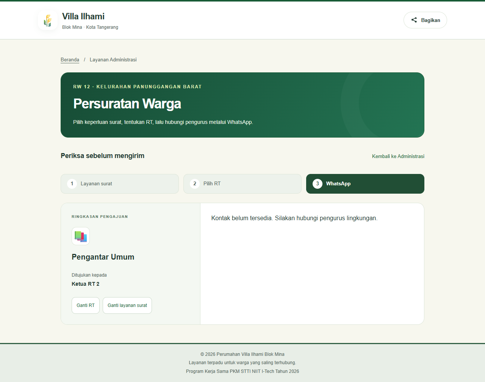
Gambar 17  RT dengan kontak belum tersedia

1. Kembali melalui Ganti RT untuk memeriksa tujuan.
2. Hubungi pengurus lingkungan bila nomor RT belum tersedia.
3. Admin melengkapi nomor melalui Administrasi kemudian Pengurus RW dan RT.

Alamat halaman: `/?layanan=administrasi&persuratan=1&surat=umum&rt=rt2`

## 18 Login pengelola

Login membatasi akses pengelolaan pada akun admin. Instalasi tidak memiliki username atau password bawaan. Akun dokumentasi digunakan hanya pada salinan database untuk pengambilan gambar.

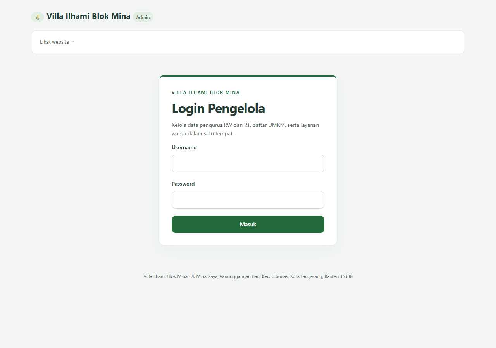
Gambar 18  Login pengelola

1. Buka /login.php.
2. Isi username dan password akun yang sudah dibuat, lalu tekan Masuk.
3. Jika kredensial salah, halaman menampilkan pesan kegagalan. Setelah lima percobaan dalam jendela 15 menit, percobaan berikutnya dibatasi. Jangan menyertakan password dalam dokumen publik.

Alamat halaman: `/login.php`

## 19 Dashboard pengelola

Dashboard menampilkan pengunjung hari ini, bulan ini, dan total serta akses pengelolaan tiga kanal. Angka dihitung berdasarkan identitas cookie browser, bukan jumlah refresh atau jumlah orang terverifikasi.

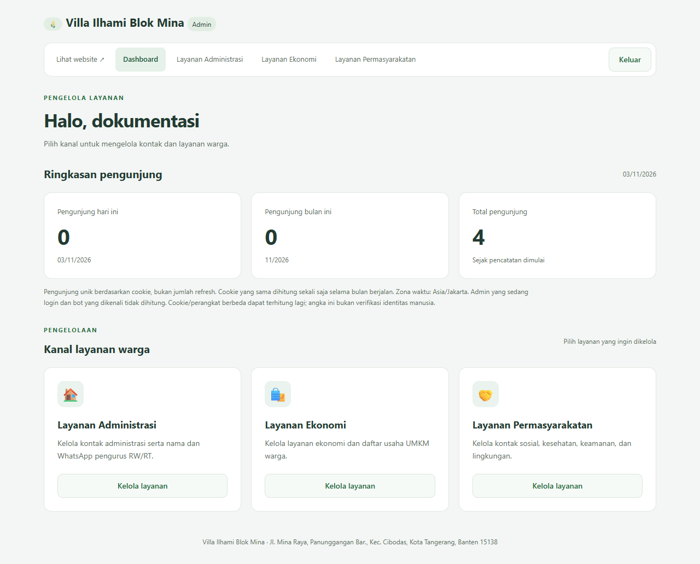
Gambar 19  Dashboard pengelola

1. Periksa Ringkasan pengunjung sesuai periode.
2. Pilih Kelola layanan pada kanal yang dibutuhkan atau gunakan menu navigasi.
3. Admin yang sedang login dan bot yang dikenali tidak dicatat sebagai pengunjung. Statistik bukan jumlah permohonan surat dan bukan laporan transaksi UMKM.

Alamat halaman: `/admin/`

## 20 Kelola Administrasi

Pengelolaan Administrasi menggabungkan kontak layanan administrasi serta pengurus RW dan RT dalam dua bagian yang dapat dibuka bergantian.

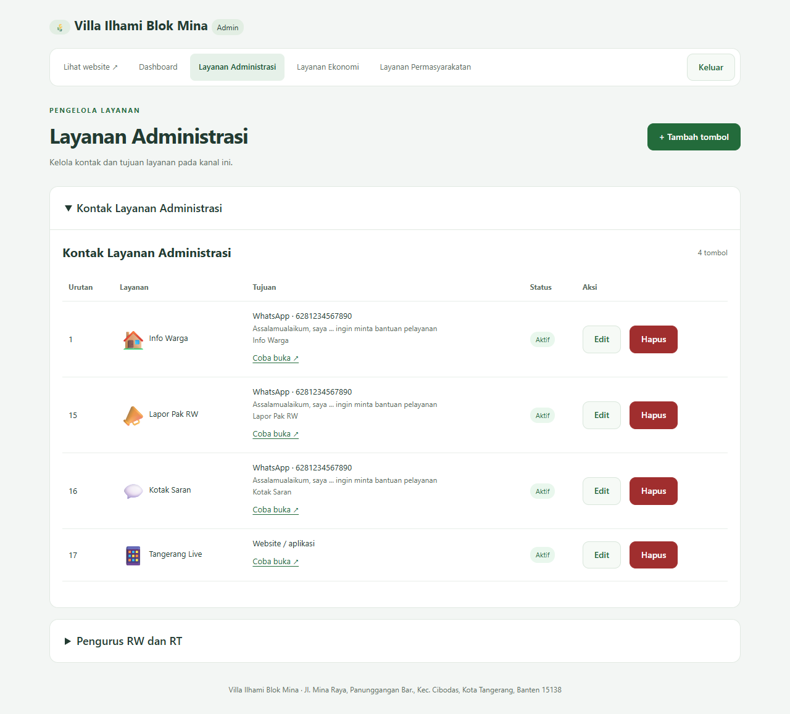
Gambar 20  Kelola Administrasi

1. Buka Kontak Layanan Administrasi untuk melihat urutan, nama, tujuan, status, dan aksi setiap tombol.
2. Tekan Tambah tombol untuk membuka popup, atau Edit pada baris yang diinginkan.
3. Gunakan bagian Pengurus RW dan RT untuk memperbarui kontak struktur lingkungan.

Alamat halaman: `/admin/?layanan=administrasi`

## 21 Kelola pengurus RW dan RT

Form Pengurus RW dan RT menyimpan nama ketua dan WhatsApp untuk RW 12 serta RT 1 sampai RT 6. Perubahan ditampilkan pada portal, dan nomor RT dipakai oleh persuratan.

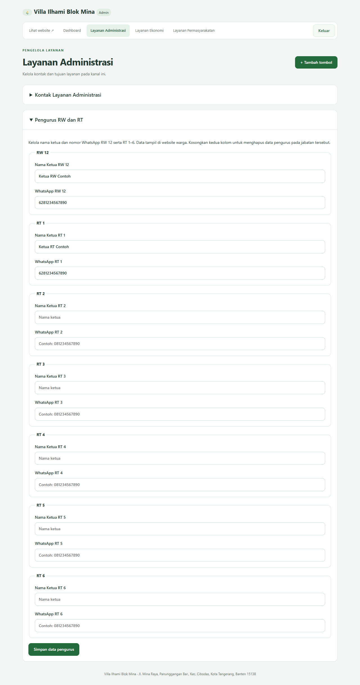
Gambar 21  Kelola pengurus RW dan RT

1. Isi nama dan nomor pada jabatan yang sesuai. Nomor dapat ditulis dengan awalan 08, 62, atau +62.
2. Tekan Simpan data pengurus setelah memeriksa seluruh isian.
3. Untuk menghapus kontak suatu jabatan, kosongkan kedua kolom nama dan nomor lalu simpan. Nama saja tanpa nomor valid tidak cukup untuk tujuan persuratan.

Alamat halaman: `/admin/?layanan=administrasi&pengurus=1`

## 22 Kelola Ekonomi

Pengelolaan Ekonomi memuat tombol layanan ekonomi dan tautan Kelola Daftar UMKM. Pengaturan tombol memakai form yang sama dengan kanal lain.

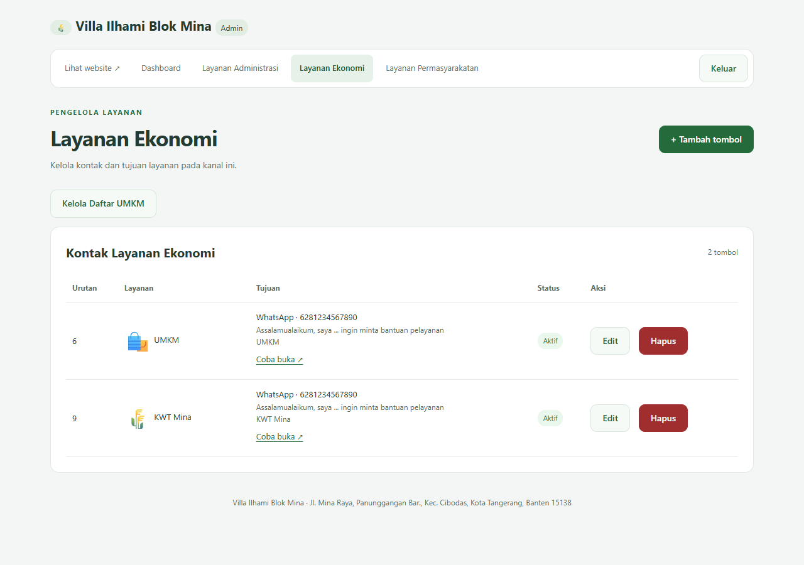
Gambar 22  Kelola Ekonomi

1. Tambah atau edit tombol layanan ekonomi.
2. Gunakan Kelola Daftar UMKM untuk mengelola data usaha.
3. Periksa tujuan melalui Coba buka hanya setelah memastikan alamat atau nomor yang dimasukkan benar.

Alamat halaman: `/admin/?layanan=ekonomi`

## 23 Kelola Permasyarakatan

Pengelolaan Permasyarakatan mengatur tombol layanan sosial, kesehatan, keamanan, dan lingkungan. Kolom status menjelaskan apakah tombol tampil kepada warga.

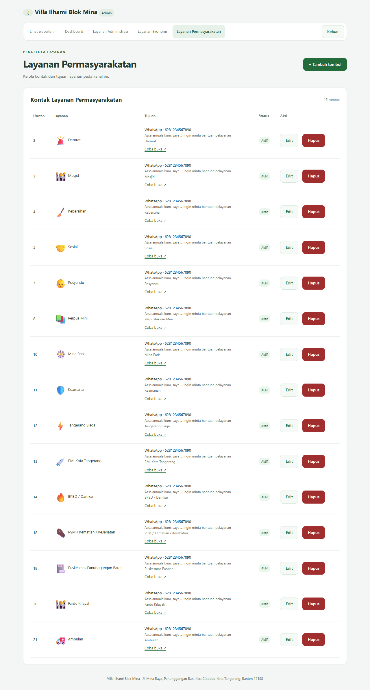
Gambar 23  Kelola Permasyarakatan

1. Tambah atau edit layanan yang dibutuhkan.
2. Atur urutan tampil dan status aktif.
3. Nonaktifkan tombol melalui Edit bila hanya ingin menyembunyikannya; gunakan Hapus untuk penghapusan permanen.

Alamat halaman: `/admin/?layanan=permasyarakatan`

## 24 Form tombol WhatsApp

Popup Tambah tombol untuk WhatsApp memuat nama, pilihan ikon, jenis tujuan, nomor, pesan pembuka, urutan, dan status tampil. Nomor dinormalisasi menjadi angka berawalan 62.

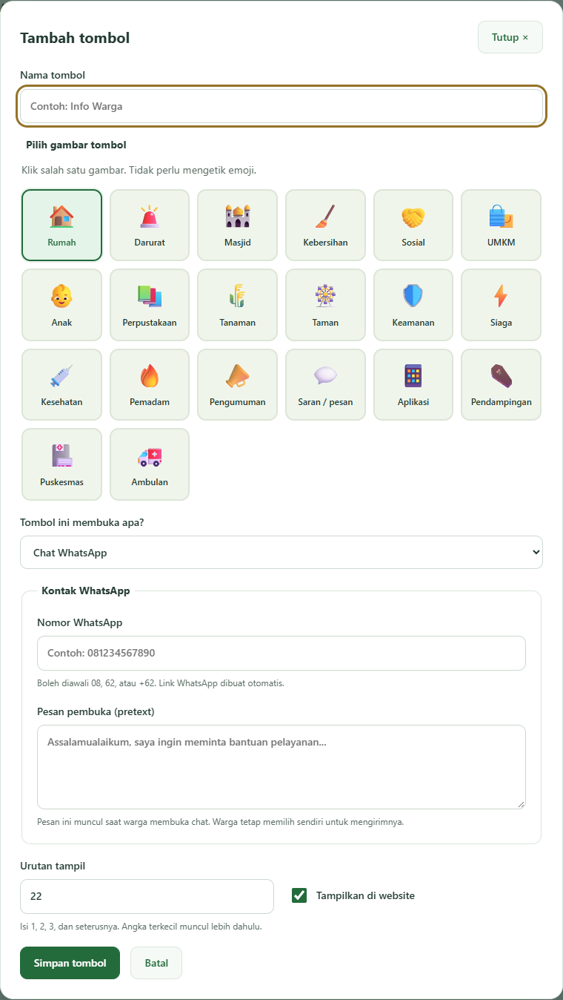
Gambar 24  Form tombol WhatsApp

1. Isi nama tombol maksimal 120 karakter dan pilih satu ikon.
2. Pilih Chat WhatsApp, isi nomor valid dan pesan pembuka maksimal 2000 karakter.
3. Atur urutan 0 sampai 1000000 dan centang Tampilkan di website jika aktif, lalu Simpan tombol. Angka terkecil tampil dahulu; urutan sama mengikuti ID.
4. Tutup, Batal, atau Escape menutup popup. Validasi yang gagal mempertahankan isian dan menampilkan penjelasan.

Alamat halaman: `/admin/?layanan=administrasi`

## 25 Form tombol website

Pilihan Website atau aplikasi lain mengganti isian kontak dengan alamat website. Tujuan harus memakai URL http atau https yang valid.

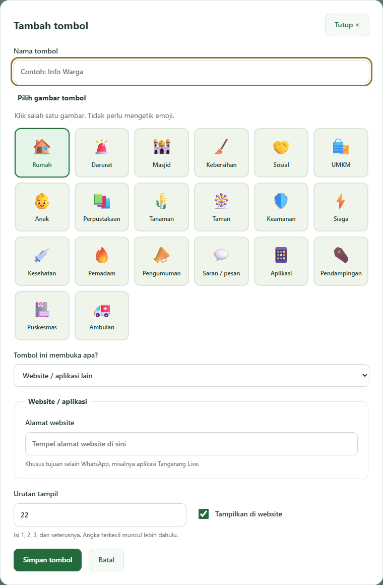
Gambar 25  Form tombol website

1. Pilih Website atau aplikasi lain pada jenis tujuan.
2. Isi alamat lengkap, misalnya https://contoh.domain/layanan.
3. Simpan setelah nama, ikon, urutan, dan status diperiksa. Pilihan ini digunakan untuk tujuan selain WhatsApp.

Alamat halaman: `/admin/?layanan=administrasi`

## 26 Edit tombol layanan

Edit membuka popup dengan nilai layanan yang tersimpan. Pengaturan aktif dapat dipakai untuk menyembunyikan tombol tanpa kehilangan data.

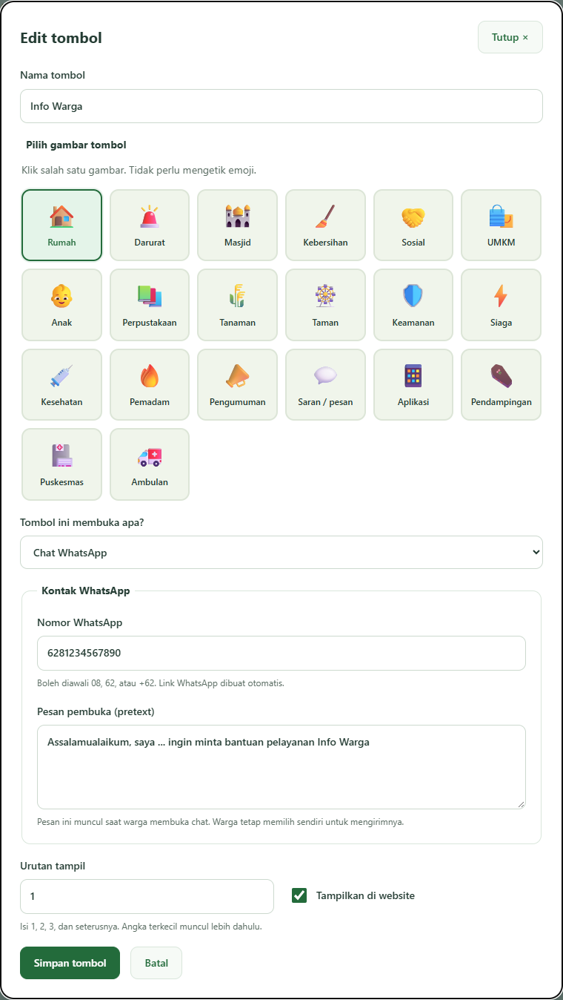
Gambar 26  Edit tombol layanan

1. Pilih Edit pada baris layanan yang benar.
2. Perbarui nama, ikon, tujuan, pesan, urutan, atau status sesuai kebutuhan.
3. Tekan Simpan tombol. Kanal mengikuti ikon: home, megaphone, chat, dan phone masuk Administrasi; shop dan plant masuk Ekonomi; ikon lain masuk Permasyarakatan. Mengubah ikon dapat memindahkan kanal.

Alamat halaman: `/admin/?layanan=administrasi&edit=1#service-form`

## 27 Konfirmasi hapus tombol

Tautan Hapus membuka halaman konfirmasi, sehingga membuka tautannya saja belum menghapus data. Penghapusan tombol bersifat permanen.

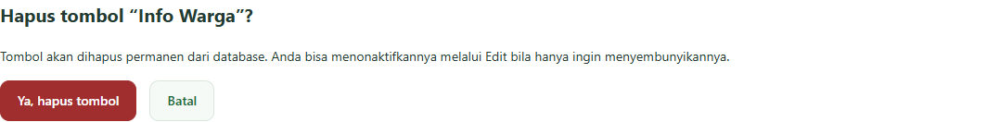
Gambar 27  Konfirmasi hapus tombol

1. Periksa nama tombol pada judul konfirmasi.
2. Tekan Batal untuk mempertahankan data.
3. Tekan Ya hapus tombol hanya jika penghapusan memang diperlukan. Persuratan adalah fitur bawaan dan tidak dihapus melalui daftar ini.

Alamat halaman: `/admin/?layanan=administrasi&delete=1#delete-title`

## 28 Daftar UMKM pengelola

Halaman Kelola UMKM menampilkan daftar usaha dengan kategori, nomor WhatsApp, penanda Data contoh, serta tautan Edit dan Hapus. Form Tambah UMKM berada di bagian bawah daftar.

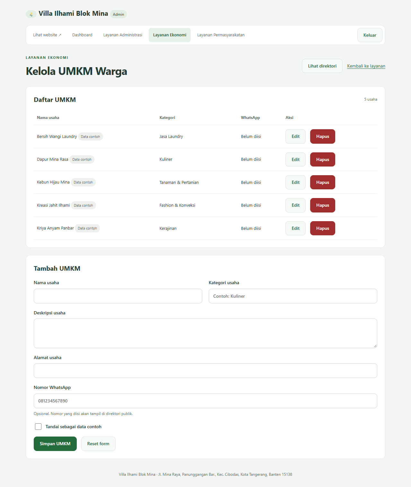
Gambar 28  Daftar UMKM pengelola

1. Buka Ekonomi kemudian Kelola Daftar UMKM.
2. Periksa data usaha yang tersedia.
3. Gunakan Lihat direktori untuk melihat tampilan warga atau Kembali ke layanan untuk kembali ke kanal Ekonomi.

Alamat halaman: `/admin/umkm.php`

## 29 Form tambah UMKM

Tambah UMKM memerlukan nama usaha, kategori, deskripsi dan alamat. WhatsApp opsional. Penanda Data contoh membedakan demonstrasi dari data usaha yang telah diverifikasi.

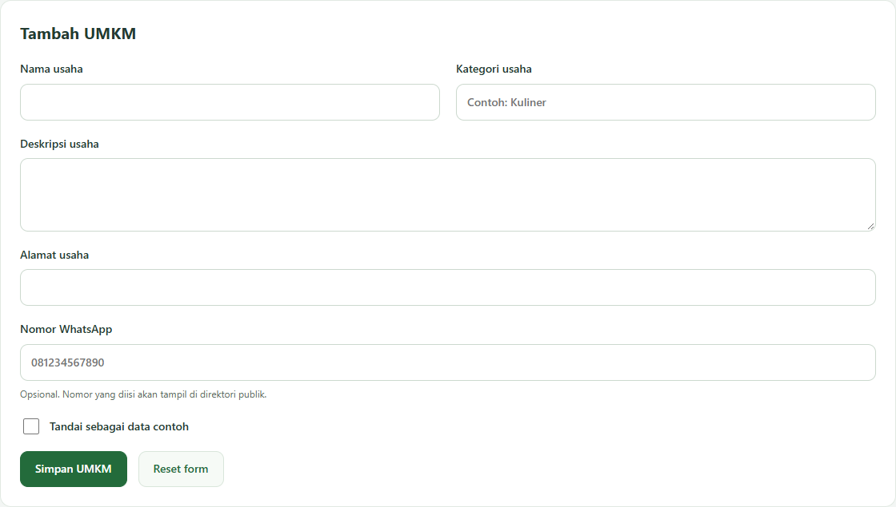
Gambar 29  Form tambah UMKM

1. Isi nama maksimal 120 karakter, kategori 80 karakter, deskripsi 2000 karakter, dan alamat 255 karakter.
2. Isi WhatsApp bila tersedia; nomor yang disimpan tampil di direktori publik.
3. Atur penanda Data contoh lalu tekan Simpan UMKM. Reset form mengembalikan form tambah kosong.

Alamat halaman: `/admin/umkm.php`

## 30 Form edit UMKM

Edit UMKM menampilkan informasi usaha yang dipilih untuk diperbarui. Data disimpan kembali pada usaha yang sama.

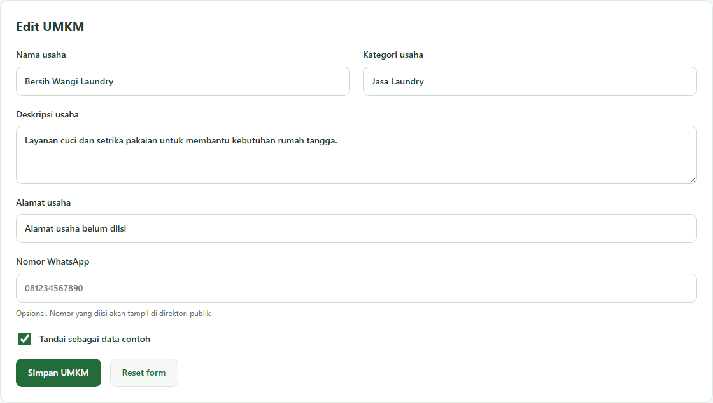
Gambar 30  Form edit UMKM

1. Pilih Edit pada usaha yang benar.
2. Perbaiki identitas, kategori, deskripsi, alamat, dan kontak sesuai data yang telah disetujui pemilik.
3. Hilangkan penanda Data contoh setelah data nyata diverifikasi, lalu Simpan UMKM.

Alamat halaman: `/admin/umkm.php?edit=4#umkm-form`

## 31 Konfirmasi hapus UMKM

Konfirmasi Hapus UMKM menampilkan nama usaha sebelum penghapusan. Usaha yang dihapus tidak lagi tersedia di direktori.

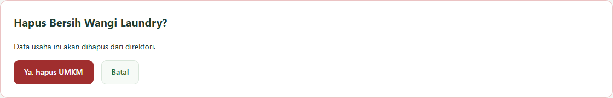
Gambar 31  Konfirmasi hapus UMKM

1. Periksa nama usaha pada konfirmasi.
2. Pilih Batal untuk kembali tanpa menghapus.
3. Gunakan Ya hapus UMKM hanya untuk data yang memang hendak dihapus permanen.

Alamat halaman: `/admin/umkm.php?delete=4`

## 32 Kembali ke login setelah keluar

Tombol Keluar mengakhiri sesi admin dan mengarahkan browser kembali ke halaman login. Halaman admin membutuhkan login kembali setelah sesi berakhir.


Gambar 32  Kembali ke login setelah keluar

1. Gunakan Keluar setelah selesai mengelola website, terutama pada komputer bersama.
2. Sesi juga berakhir setelah 30 menit tidak aktif atau maksimal 8 jam sejak login.
3. Reset password melalui CLI belum otomatis mencabut sesi lain yang masih aktif.

Alamat halaman: `/login.php`

## 33 Beranda pada ponsel

Pada layar ponsel, isi portal tersusun vertikal agar kanal tetap dapat dibuka melalui layar sentuh. Screenshot ini diambil pada viewport 390 kali 844 piksel.

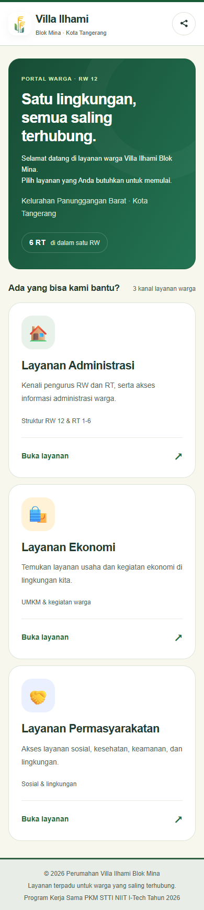
Gambar 33  Beranda pada ponsel

1. Buka alamat website pada browser ponsel.
2. Gulir untuk menjangkau kanal dan tombol lain.
3. Gunakan Bagikan untuk menyalin atau membagikan alamat sesuai dukungan browser.

Alamat halaman: `/`

## 34 Persuratan pada ponsel

Alur persuratan pada ponsel memuat ringkasan penerima dan pesan yang sama dengan desktop. Aplikasi WhatsApp tujuan bergantung pada perangkat yang digunakan.

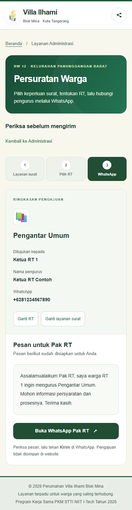
Gambar 34  Persuratan pada ponsel

1. Periksa jenis layanan dan RT tujuan.
2. Baca pesan yang telah disiapkan, lalu tekan Buka WhatsApp Pak RT.
3. Tinjau kembali pesan di WhatsApp dan tekan Kirim sendiri. Website tidak menyimpan pengajuan atau mengirim pesan otomatis.

Alamat halaman: `/?layanan=administrasi&persuratan=1&surat=umum&rt=rt1`

## Menjalankan lokal dengan MySQL

Aplikasi menggunakan PHP tanpa framework, Composer, npm, atau proses build. Gunakan PHP 8.2 atau lebih baru dengan pdo_mysql dan mbstring, serta MySQL atau MariaDB dengan InnoDB dan utf8mb4.

- Nyalakan MySQL melalui Laragon.
- Buka PowerShell pada E:\laragon\www\kwt-go.
- Pastikan config.local.php menunjuk database MySQL yang aktif.
- Jalankan php -S localhost:4173 -t public lalu buka http://localhost:4173/.
- Biarkan terminal server terbuka. Gunakan Ctrl+C untuk menghentikannya. Jika port sudah digunakan, buka server yang ada atau gunakan port lain dan sesuaikan base_url.

Konfigurasi aktif lokal berada pada config.local.php yang tidak masuk Git. Nama database lokal hasil perpindahan adalah kwt_go_mysql_20261103_122052. Jangan gunakan database dokumentasi sebagai database operasional. File SQLite lama tetap merupakan cadangan historis dan tidak lagi tersinkron dengan MySQL.

## Contoh konfigurasi MySQL

```php
'db' => [
    'driver' => 'mysql', 'host' => '127.0.0.1', 'port' => 3306,
    'name' => 'nama_database', 'user' => 'user_aplikasi',
    'password' => 'ISI_DI_KONFIGURASI_PRIVAT', 'socket' => '',
],
'base_url' => 'https://domainkamu.com',
'timezone' => 'Asia/Jakarta',
```

app_key harus berupa 64 karakter hex acak. Pertahankan key instalasi yang sama saat memindahkan aplikasi. Jangan masukkan kredensial atau key nyata ke dokumentasi maupun repository.

## Instalasi MySQL baru dan akun admin

- Buat database kosong dan user khusus aplikasi melalui panel hosting.
- Impor database/schema.sql kemudian database/seed.sql hanya pada database kosong.
- database/umkm-seed.sql bersifat opsional dan berisi usaha demonstrasi.
- Buat config.local.php dengan driver mysql dan kredensial privat. Perhatikan config.example.php pada repository masih merupakan contoh SQLite; blok db perlu diganti untuk MySQL.
- Buat akun admin melalui scripts/create-admin.php dengan password dikirim melalui stdin. Tidak ada akun default.

Username menerima 3 sampai 100 karakter berupa huruf, angka, underscore, titik, atau tanda minus. Password harus 12 sampai 72 byte. Akun runtime cukup mendapat SELECT, INSERT, UPDATE, dan DELETE; impor skema dilakukan dengan akun pengelola yang memiliki izin DDL.

Contoh PowerShell berikut membaca password tanpa menampilkannya pada layar. Ganti admin dengan username yang dipilih.

```powershell
$secure = Read-Host 'Password admin' -AsSecureString
$plain = [System.Net.NetworkCredential]::new('', $secure).Password
$plain | php scripts/create-admin.php admin
Remove-Variable plain, secure
```

Untuk mengganti password akun yang ada, tambahkan --reset setelah username pada perintah create-admin.php. Reset tidak langsung mencabut sesi yang sedang aktif. Jangan menjalankan impor seed ulang pada database berisi data warga.

## Pembaruan instalasi lama

Skema database tidak otomatis diperbarui ketika halaman dibuka. Instalasi MySQL lama mungkin memerlukan scripts/migrate-service-inputs.php, scripts/migrate-structure-contacts.php, dan scripts/migrate-umkm.php sesuai struktur asal. Buat backup dan hentikan perubahan data sebelum migrasi; baca docs/deployment.md sebelum menjalankannya.

## Menyiapkan hosting PHP dan MySQL

- Pastikan hosting menyediakan PHP 8.2 atau lebih baru, pdo_mysql, mbstring, dan MySQL atau MariaDB.
- Backup database dan konfigurasi lokal. Buat database dan user khusus pada hosting.
- Ekspor database MySQL aktif dengan fasilitas backup hosting atau mysqldump --single-transaction, kemudian impor ke database hosting. Kredensial akun aplikasi yang dipindahkan tetap berada dalam hash password.
- Upload folder app dan public serta konfigurasi yang diperlukan. Jangan unggah .git, .local, database dokumentasi, file backup, atau data pengujian ke lokasi publik.
- Arahkan document root domain ke public. Folder app dan config.local.php tetap di luar akses HTTP.
- Ubah host, port, nama database, username, password, dan base_url HTTPS sesuai hosting. Pertahankan app_key instalasi yang dipindahkan.
- Aktifkan HTTPS, matikan display_errors serta directory listing, dan pastikan penyimpanan sesi PHP dapat ditulis.
- Periksa portal, login, setiap kanal, persuratan, direktori UMKM, dan perubahan konten yang diperlukan. Jangan menjalankan suite tes mutasi pada database produksi.

Jika panel hanya menyediakan public_html, minta penyedia mengatur document root atau pemetaan direktori yang mempertahankan struktur privat aplikasi. Jangan memindahkan seluruh proyek ke folder publik. Server php -S dipakai untuk pengembangan lokal; hosting memakai layanan web dan PHP yang disediakan server.

Halaman PHP tidak boleh dicache penuh karena cookie dan bukti kunjungan bersifat per browser. Aset CSS dan JavaScript boleh dicache. Gunakan refresh bila tampilan aset belum berubah. Domain atau QR cetak baru dibuat setelah URL publik tersedia; QR localhost tidak dapat dipakai warga dari perangkat lain.

## Backup pemulihan dan pemeliharaan

- Buat backup MySQL yang konsisten sebelum memperbarui kode atau memigrasikan skema. Gunakan fasilitas backup panel atau mysqldump --single-transaction untuk tabel InnoDB.
- Simpan salinan config.local.php secara privat dan terpisah dari backup database. Lindungi file karena berisi kredensial dan app_key.
- Saat memperbarui kode, pertahankan database hosting serta konfigurasi produksi. Jangan timpa dengan database lokal yang lebih lama.
- Untuk pemulihan, hentikan penulisan, simpan kondisi database saat ini, pulihkan backup dan konfigurasi yang sesuai, lalu verifikasi sebelum membuka akses.
- Periksa nomor layanan, pengurus, dan usaha secara berkala. Hilangkan data demonstrasi yang belum diverifikasi sebelum publikasi.

## Keamanan dan batas fitur

Aplikasi menggunakan hash password, prepared statements, validasi input, CSRF, pengamanan sesi, dan pembatasan percobaan login. Tidak ada pengaturan akun atau ganti password melalui halaman admin; pembuatan dan reset dilakukan lewat CLI.

Persuratan tidak memiliki unggah KTP, NIK, nomor tiket, riwayat, pelacakan status, atau penerbitan dokumen otomatis. Klik WhatsApp hanya menyiapkan percakapan. Pengelola perlu memastikan tujuan benar; tindakan mengirim pesan berada di aplikasi tujuan.

Statistik tidak menyimpan IP atau User Agent mentah pada tabel analitik. Cookie atau perangkat berbeda dapat menghitung orang yang sama lebih dari sekali. Tidak tersedia verifikasi identitas manusia, CAPTCHA, atau pembersihan historis pengunjung otomatis.

## Mengatasi kendala umum

Gunakan terminal Laragon atau tambahkan direktori PHP ke PATH.

Pastikan MySQL menyala serta host, port, nama database, user, password, dan izin pada config.local.php benar.

Aktifkan pdo_mysql pada PHP yang dipakai web. PHP CLI dan web bisa memakai php.ini berbeda.

Periksa log PHP, koneksi MySQL, skema tujuh tabel, serta app_key yang wajib 64 karakter hex.

Samakan hostname, port, dan protokol dengan base_url. Pastikan cookie aktif dan folder sesi PHP dapat ditulis.

Tunggu jendela pembatasan 15 menit. Jangan menguji login berulang pada database aktif.

Isi nomor WhatsApp valid melalui Administrasi kemudian Pengurus RW dan RT.

Periksa ikon karena pemetaan kanal mengikuti ikon tombol.

Gunakan browser non-admin dengan cookie dan JavaScript aktif. Halaman harus terlihat setidaknya satu detik; bot yang dikenali tidak dihitung.

Gunakan server yang sudah ada atau pilih port baru dan sesuaikan base_url.

## Daftar halaman dan hasil pemeriksaan

Cakupan antarmuka meliputi beranda, tiga kanal publik, direktori UMKM, pilihan surat, pilihan RT, delapan ringkasan jenis surat, kondisi kontak kosong, panel Bagikan, login, dashboard, tiga kanal admin, pengurus, popup tambah dan edit tombol, konfirmasi hapus, daftar dan form UMKM, logout, serta contoh tampilan ponsel.

Endpoint track.php menerima pencatatan kunjungan melalui POST dan tidak memiliki halaman pengguna. admin/structure.php merupakan jalur kompatibilitas menuju pengelolaan pengurus, bukan halaman terpisah. File CSS, JavaScript, dan aset bukan halaman dokumentasi.

Screenshot desktop diambil pada viewport 1280 kali 900 piksel, form panjang pada 1280 kali 2000 piksel, dan ponsel pada 390 kali 844 piksel. Akun dokumentasi berhasil login dan keluar melalui antarmuka. Popup dan konfirmasi dibuka tanpa menghapus data. Tindakan mengirim WhatsApp, berbagi ke akun media sosial, dan deployment hosting tidak dilakukan.

## Dokumen pendukung repository

- docs/user-guide.md menjelaskan penggunaan warga dan pengelola.
- docs/deployment.md memuat instalasi serta migrasi MySQL.
- docs/analytics.md memuat definisi dan batas statistik.
- docs/development.md memuat struktur kode serta perintah pengujian.
- docs/manual/screenshots berisi screenshot asli dan manifest halaman untuk panduan ini.
